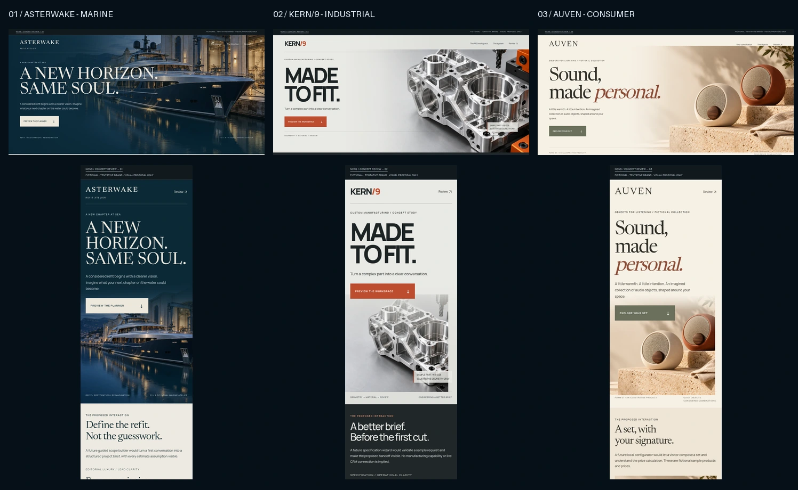

# Milestone C1 — three portfolio directions

**Visual approval first.** These are three original fictional proposals, not client case studies or complete interactive demos. Names are tentative, with trademark/domain clearance still required. Proposed controls are intentionally inactive and labelled as illustrative. Only the review navigation works in C1.

Prepared from approved `main` commit `0d24fd4e2e84334a71548421a35a0eb986ae6ae9` in `codex/milestone-c1-portfolio-design`. The agency website, its animations, original NCNS emblem and existing Selected Work section are unchanged. No Sable House case, NCNS-Bro content or prior rejected design was imported.

## Image-first review

[Open the separate NCNS review index](index.html) · [Three-direction selection sheet](screenshots/three-directions.webp)

The six primary screenshots are real Chromium renders of independent HTML/CSS boards, with live text and original locally hosted imagery. Each full board includes a hero and a representative future functional module. No full-page website screenshot is used as a background.

| Direction | Desktop — 1440px | Mobile — 390px | Viewable source |
| --- | --- | --- | --- |
| **01 / Asterwake** — premium marine/refit | [Full visual board](screenshots/asterwake-1440.png) | [Full visual board](screenshots/asterwake-390.png) | [HTML](boards/asterwake.html) |
| **02 / Kern/9** — custom manufacturing | [Full visual board](screenshots/kern9-1440.png) | [Full visual board](screenshots/kern9-390.png) | [HTML](boards/kern9.html) |
| **03 / Auven** — design-led consumer audio | [Full visual board](screenshots/auven-1440.png) | [Full visual board](screenshots/auven-390.png) | [HTML](boards/auven.html) |

The `*-module-*.png` files provide native-width close-ups. Additional 360px renders check the smaller mobile layout. Desktop/mobile boards were visually inspected; missing diagonal-arrow glyphs were replaced with inline SVG before final capture.

## Comparison matrix

| | Asterwake | Kern/9 | Auven |
| --- | --- | --- | --- |
| Commercial problem | Vague refit enquiries conceal scope and assumptions | Incomplete technical RFQs create avoidable review loops | Product combinations and total pricing are difficult to understand |
| Visual identity | Oceanic navy, warm paper, wide serif typography, editorial yacht art | Mineral grey, graphite, emphatic typography, machined metal, restrained orange | Warm cream, ceramic/linen/walnut, expressive editorial serif, terracotta/olive |
| Distinct skill | Premium service positioning + transparent estimate UX | Lead qualification + validation + operational automation modelling | Visual brand + accessible product configuration + pricing logic |
| Proposed primary flow | Vessel → scope → assumptions → nonbinding range → copy/export brief | Specification → constraint checks → simulated routing → reviewable RFQ packet | Finish → quantity → optional base → transparent total → copy configuration |
| Functional in a later approved demo | Deterministic model, range arithmetic, validation, editable brief and local export | Actual input validation, rule flags, in-memory queue simulation and local packet export | Actual integer-cent arithmetic, option state, itemised summary and local export |
| Explicitly simulated / absent | Invented cost model; no supplier quote, survey, booking or actual refit | Sample metadata/geometry; no CAD analysis, real CRM writes, machining feasibility claim or email | Fictional products/prices; no inventory, tax/shipping engine, checkout, payment or order |
| Potential value to evaluate | Scope completeness and comprehension of assumptions | Completeness before review and time to understand exception states | Price comprehension and ability to complete a configuration |
| Indicative later build scope | 4–6 focused implementation days | 6–9 focused implementation days | 3–5 focused implementation days |

Build ranges are planning estimates for a single scoped client-side flow after visual approval, including responsive/accessibility QA. They are not a commercial quote or delivery commitment. Asset revisions, production integrations and owner feedback add scope. No numerical business improvement is claimed; potential value must be evaluated in usability tasks rather than invented client metrics.

## Recommendation

**1. Start with Kern/9.** It provides the strongest complementary proof to the already cinematic agency site: a distinct technical identity, structured lead qualification, explainable rule checks and a visible, honest operational handoff. The simulated routing is deliberately bounded and does not need a real CRM. Its main risk is scope expansion into CAD parsing or real manufacturing advice; those remain out of scope.

**2. Follow with Asterwake.** Strongest luxury-service positioning and editorial atmosphere. The guided estimate can be compelling if every invented coefficient and assumption stays visible. The risk is treating illustrative pricing as a real supplier quote; the later UI must make the nonbinding model unmistakable.

**3. Add Auven for range.** Strongest brand/commerce contrast and the smallest implementation scope. Transparent set arithmetic makes a reliable, accessible interactive demonstration. It offers less operational differentiation than Kern/9, but is the best first choice if the owner's immediate priority is consumer-brand art direction rather than workflow depth.

This ranking is a recommendation, not approval to build. The owner may choose one, several or a blend; retain separate identities rather than turning all three into agency-site reskins.

## Architecture and implementation definition

- [Information architecture and canonical static routing](architecture.md): future `/work/` and `/work/<slug>/`, isolated demo shells, NCNS return path, index consistency, approval boundaries.
- [Detailed future flows, validation and acceptance cases](flows.md): concrete state/data models, transparent sample calculations, simulated/functional boundaries and failure states for each direction.
- [Asset provenance, licensing and measured sizes](assets/PROVENANCE.md): original generated imagery, official local Newsreader font and reuse of licensed Manrope.

## C1 checks and scope boundary

Run the repository's static server, then `python3 tests/portfolio_concepts.py` (Python Playwright, Pillow and system Chromium required). No frontend install or build step. The review entry is `/docs/portfolio/concepts/`; it is not a deployed portfolio URL.

Final Chromium validation covers 1440×1000, 390×844 and 360×780 for all three concepts: imagery and fonts load locally, no JS errors, resource failures or horizontal overflow; proposed action buttons are disabled; no board scripts or complete demo logic exist. The separate index opens a board and returns correctly with JavaScript disabled. See [render results](screenshots/results.json).

Measured board subresources are approximately 486 KB Asterwake, 218 KB Kern/9 and 474 KB Auven on fresh local navigations (HTML excluded). These are proposal measurements, not production performance claims. The future demos should add responsive images, a small local JS module and measured LCP/CLS budgets after direction approval.

**Owner decision needed:** approve or revise the visual direction(s) before any functional demo development. No agency-site edit, merge, deployment, domain, backend, payment, analytics or real integration is included in C1.

### Draft PR status

The branch is pushed as `codex/milestone-c1-portfolio-design`. The requested `gh pr create --draft --base main` attempt returned `Post https://api.github.com/graphql: Forbidden`; no PR creation is claimed. Per Issue #6's fallback, the branch and [ready PR description](PR.md) are available for the owner/assistant to open the draft PR. All design-review artifacts are committed; this does not authorise complete demo development.
