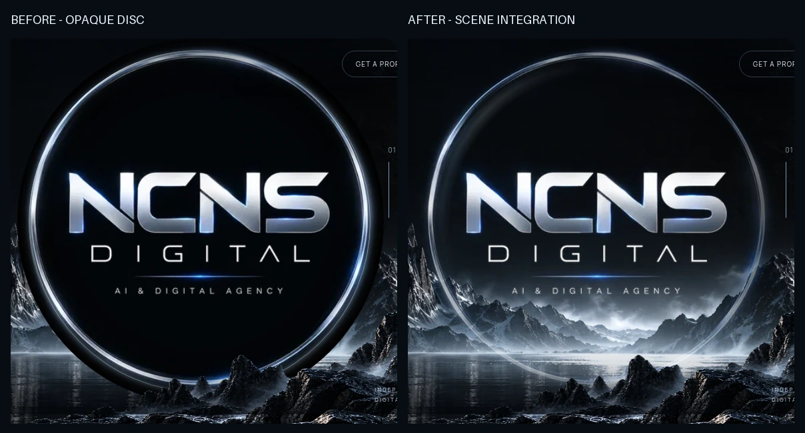

# Emblem integration — latest owner review on PR #2

Targeted hero polish only. The approved layout, typography, services and later sections remain in place. The original `assets/ncns-original-logo.webp` is unchanged (SHA-256 `75b0a8357126199bae258710941d5b7dccdeb4492607e7a123787a59a327fd01`). No lettering was generated, repainted or replaced, and no derived raster file was needed.

## What changed

- **Disc:** screen compositing lets existing scene light pass through the source artwork's black pixels. Soft edge and lower masks remove the hard pasted-circle silhouette. A soft local mobile backdrop protects the lettering where the mountain crosses it; it has no hard disc edge.
- **Rim:** the original artwork supplies the main rim. The separately drawn full CSS border and stationary highlight were removed. Directional attenuation and a faint moving glint vary intensity without presenting a second complete ring.
- **Base:** the unchanged foreground rocks occlude the base; a soft lower fade and local haze make it recede into the horizon instead of exposing a complete coin outline. There is no horizontal crop.
- **Water:** the flipped emblem image is removed from the DOM. Three faint, narrow, blurred and horizontally displaced specular streaks sit on the desktop water plane. They contain no letters or logo. Mobile omits these secondary effects.
- **Restraint:** no extra scene assets, palette changes or section redesigns. The 480px source remains a 480px source: modest browser enlargement cannot add authentic detail, and no false high-resolution claim is made.

## Visual evidence

[Before / after close-up](emblem/before-after-closeup.webp) uses the **same 580×578 viewport rectangle** in both actual 1440px Chromium captures. [Approved / updated close-up](emblem/reference-actual-closeup.webp) maps that same normalized page rectangle onto the reference, then scales it uniformly; it does not align or rearrange elements to conceal differences.



[Full reference / actual 1440×900](approved-vs-actual.webp) · [Equal-width hero/services comparison](approved-vs-actual-focus.webp)

Updated PNG screenshots: [1440](after-1440.png), [768](hero-768.png), [390](hero-390.png), [360](hero-360.png). Their corresponding `screenshot-*.png` files contain the full page. Desktop and mobile captures were visually inspected; the mobile backdrop was revised after the first inspection exposed a bright mountain through part of the wordmark.

## Real-browser animation evidence

- [Desktop Chromium recording — 13.6s, 1440×900](emblem/chromium-motion.webm): halo glint, slow atmosphere/water motion and restrained pointer-driven depth. [Capture metadata](emblem/chromium-motion.json).
- [Mobile Chromium recording — 8.8s, 390×900](emblem/chromium-mobile-motion.webm): slower halo with desktop depth and secondary water effects disabled. [Capture metadata](emblem/chromium-mobile-motion.json).

These are CDP screencasts of the actual running Chromium page with normal motion, encoded as VP9 WebM using captured frame timestamps. They are not loops assembled from still QA screenshots. Decoding verified 104 distinct desktop frames and 218 distinct mobile frames; animation clocks advanced and no JavaScript errors were recorded. Static QA PNGs use reduced motion for reproducibility; they are not presented as animation evidence.

Reproduce with the local server running:

```sh
python3 tests/browser_smoke.py
python3 tests/prepare_reference.py reference/approved-concept.webp
python3 tests/record_emblem.py
python3 tests/record_emblem.py --mobile
```

Recording requires installed Chromium, Python Playwright and system FFmpeg. It captures frames into a temporary directory and cleans them after encoding. There are no runtime application dependencies added.

## Checks and remaining deviations

Real Chromium checks passed at **1440, 768, 390 and 360px**: no horizontal overflow, uncaught JS errors or failed resources; original logo loaded; menu, service navigation, brief fallback and pointer depth work; reduced motion removes animation and transforms. Screenshots show mobile foreground/wordmark visibility. Latest [results](results.json) show approximately 680 KB desktop / 370 KB mobile and observed layout shift below 0.001 in this local run.

The scene and source artwork remain independently composed rather than a physical 3D render. Glass texture, geology and reflections are not pixel-identical to the approved mockup; source-logo resolution is unchanged. Screen blending can vary slightly with the underlying terrain, so owner visual approval is still required. The recording is desktop Chromium plus mobile viewport emulation, not a real handset test or a production performance audit.

**PR #2 remains draft. No merge, deployment or portfolio development.**
