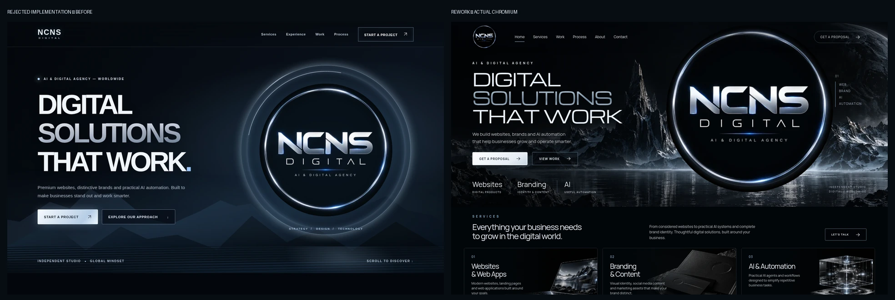

# Issue #3 — visual rework for draft PR #2

Status: **redesigned implementation submitted for owner review; the exact reference-file/comparison gate is still incomplete**. No merge, deployment, domain change or portfolio development was performed.

## Reference and comparison limitation

The owner-attached full-page approved concept was visually inspected in the conversation, alongside the rejected desktop screenshots. Its original downloadable file was not mounted in the workspace. Consequently `reference/approved-concept.webp`, a QA copy of that target and the genuine **approved-reference / actual-browser** collage cannot yet be committed. No regenerated image has been mislabelled as the approved reference.

Provide the original attachment as a downloadable PNG/WebP file; `python3 tests/prepare_reference.py /path/to/original.png` will preserve its full composition, encode the exact source at quality 92, save it alongside this report, and generate the required two-column collage. That collage must then receive an actual visual review. This missing gate prevents claiming full compliance with issue #3.

Available comparison: [rejected implementation versus rework](before-vs-after.webp). This is explicitly **before / after**, not approved / actual.

## Comparison against the visible approved attachment

| Area | Approved direction | Rework and remaining deviations |
| --- | --- | --- |
| Hero composition | Thin architectural heading on the left; giant original circular emblem on the right | Rebuilt with live Michroma typography, a 550px independent emblem on a 610px desktop hero, restrained CTAs and dark negative space. Mobile stacks the hierarchy. Exact pixel overlay remains pending the source file. |
| Header | Slender black header, small real emblem, quiet links and outlined CTA | Original owner asset replaces the generic wordmark. Home, Services, Work, Process, About and Contact resolve to real sections. Proposal CTA leads to the honest offline brief, not an invented booking backend. |
| Mountain / lake / planet | Detailed black rock, wet water reflections, haze and a muted planetary rim | Polygon ridges and striped CSS water removed entirely. A locally hosted generated photographic environment supplies the terrain, lake and planet; independent mist, water glint and parallax add depth. This is a new illustrative scene, not the exact scene from the reference. |
| Emblem and lighting | Original metallic lettering, silver/ice-blue circular edge integrated with the scene | Original logo bytes unchanged. Narrow halo sweep, soft pulse, shallow desktop depth and a subtle reflected duplicate; no generated lettering. The source emblem is 480px, so it is softer than a bespoke high-resolution render. It remains a composited emblem, not a physically simulated 3D object. |
| Services | Three horizontal panels: laptop, black stationery, glass technical module | Replaced all geometric placeholders with an optimized local photographic atlas; live headings, descriptions and actionable links remain separate. Artwork composition differs from the approved image and contains no fabricated customer identity. |
| Spacing / colour | Dense cinematic first screen and compact services; near-black, silver, pale blue | Hero height and compact horizontal cards bring services directly below the scene. Saturated effects removed; palette remains near-black, chrome and restrained blue. |
| Claims / later sections | Mockup contains illustrative metrics and projects | Unsupported metrics replaced with capability labels. Existing Selected Work remains an explicit unreleased-concept placeholder. Existing Process and interactive demo retained; no new portfolio projects or fake proof. |

## Visual iteration performed

[First new rendering](first-pass-1440.png) was reviewed against the visible attached concept and the rejected implementation. Its waterline was too high and bright rock texture competed with body copy. The scene was reframed to lower the lake horizon while keeping the central peak tall; a local left-side shade protects typography. The unnecessary logo isolation and broad background disc were reduced, the emblem lifted slightly and a faint reflection added. The original small header mark is clipped only at its square black corners, preserving the circular emblem. Compare that first rendering with [the revised 1440×900 rendering](after-1440.png).

Desktop, 390px and 360px screenshots were visually inspected. Mobile retains a complete emblem, readable headline and both CTAs; cards stack vertically. Heavy desktop parallax and moving haze are disabled on mobile. The halo uses a slower sweep; reduced motion disables animations and transforms entirely.

## Browser validation

Run `python3 -m http.server 8000 --bind 127.0.0.1` from the repository root, then `python3 tests/browser_smoke.py` in another shell. Requires Python Playwright and system Chromium. No frontend dependency installation or build step.

The final Chromium run passed at **1440, 768, 390 and 360 × 900**:

- HTTP 200; zero failed requests, HTTP resource errors, uncaught JavaScript errors or horizontal overflow.
- Original header and hero logos, scenery and locally licensed fonts load.
- Mobile menu toggles, Escape restores focus, anchor targets receive focus, all three services lead to the brief section.
- Workflow controls and offline brief copy fallback retain their functionality.
- Halo animation clock advances; desktop scene depth responds; mobile depth is disabled; reduced motion removes halo animation and transforms.
- Blocking both local fonts still leaves usable, non-overflowing fallback typography at 1440 and 360px. Content remains visible with JavaScript disabled.

[Machine-readable results](results.json) include resource bytes and observed layout shift during this local smoke run: roughly **452 KB desktop / 365 KB mobile**, layout shift below **0.001** across the four sizes. These are local browser observations, not a production performance benchmark or a complete accessibility audit. No business backend is connected.

## Screenshots

| Width | Initial viewport | Full page |
| --- | --- | --- |
| 1440 | [Desktop](after-1440.png) | [Full page](screenshot-1440.png) |
| 768 | [Tablet](hero-768.png) | [Full page](screenshot-768.png) |
| 390 | [Mobile](hero-390.png) | [Full page](screenshot-390.png) |
| 360 | [Small mobile](hero-360.png) | [Full page](screenshot-360.png) |

[Fallback desktop](fallback-1440.png) · [Fallback mobile](fallback-360.png) · [Asset provenance, dimensions and sizes](../../../assets/scenery/README.md)

**Owner approval is still required.** Keep PR #2 draft. Finish the original-reference/collage gate before treating this visual review as complete; do not merge or publish the site.
