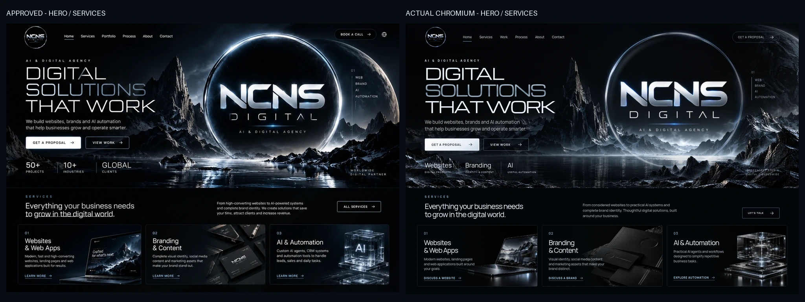

# Issue #3 — exact-reference visual review for draft PR #2

Status: the exact reference is committed, side-by-side review and a further visual revision are complete, and the redesigned milestone A is awaiting **owner visual approval**. PR #2 must remain draft. No merge, deployment, domain change or portfolio development was performed.

## Exact reference and comparison

The owner supplied `NCNS-approved-reference-for-Codex.zip`. Its optimized `approved-concept.webp` is copied **byte-for-byte** into [the reference directory](../../../reference/approved-concept.webp) and [alongside this QA report](approved-target.webp): 1223 × 1286, 220,720 bytes, SHA-256 `e78ad3ca39a7de6e72c1f2baf29984195dd98c32e7c18b210ace5f940544b4fa`. The missing-file blocker is resolved. The full mockup is not used as the application's background.

- [Full approved reference beside the actual 1440×900 Chromium viewport](approved-vs-actual.webp). Each column is independently scaled to the same width; the approved image retains its full composition, while the actual image is explicitly the 900px viewport.
- [Hero/services scope comparison](approved-vs-actual-focus.webp): both columns at the same width, cropped only to the authorized hero/services scope. The actual right column comes from the full-page Chromium screenshot at 1440px width, without rearranging the page or hiding elements.
- [Actual 1440×900 screenshot](after-1440.png), [full page](screenshot-1440.png), and [pre-reference-review implementation](pre-reference-review-1440.png).

## Differences identified and corrected from the side-by-side

The first comparison showed a dim narrow rim, a floating lower emblem edge, undersized supporting text and service labels, slightly wide SOLUTIONS / THAT WORK lettering, and a hero boundary below the target's corresponding boundary. The further revision:

1. Added a restrained stationary chrome highlight and luminous silver edge around the original emblem, retaining the real moving halo sweep and slow pulse.
2. Added an independently generated transparent wet-rock foreground that occludes the lower emblem edge and frames the lake. This is a separate local image layer, not a flattened website. A dark local backing keeps capability labels readable over the rocks.
3. Increased desktop supporting copy, CTA text, service numbers, headings and descriptions to better match the reference's hierarchy. Tightened spacing in the two wider title lines and adjusted their vertical placement.
4. Matched the 1440px hero boundary more closely (604px high), retaining the already-revised lake horizon and tall central mountain.
5. Kept the new foreground out of mobile network requests with responsive source selection. Mobile retains its tested stacked hierarchy and disables expensive depth effects.

The final comparison and desktop/mobile screenshots were visually reviewed after these changes; functional tests alone are not the basis for this visual review.

## Final comparison and deliberate deviations

| Area | Result and remaining difference |
| --- | --- |
| Hero layout / spacing | Live architectural title and CTAs left; giant original emblem right; compact services directly below. The reference's basic layout and hierarchy are reproduced with independent elements. Title font geometry is close but not identical to the rendered mockup lettering. |
| Emblem scale / metallic lighting | Original owner logo file is unchanged. Chrome rim, optical highlight, animated sweep, haze, foreground overlap and a faint reflected duplicate create depth. The original source is 480px, so it remains softer than the mockup's bespoke high-resolution emblem. Its inner black glass does not reproduce every scratch or reflection in the reference. |
| Mountain / water / planet | Realistic textured local illustrative environment, central peak, reflected lake, subdued planet and separate foreground replace all polygon mountains and striped CSS water. The generated geology, planet and water texture differ from the exact mockup; this is an independently rebuilt scene, not a copy cut from the reference. |
| Type / colour | Local licensed Michroma and Manrope; near-black, chrome/silver and restrained ice-blue. Desktop copy and service hierarchy were revised from the actual comparison. No remote font dependency. |
| Services | Three horizontal photographic cards: laptop, embossed black stationery, translucent circuitry module. Live actionable text remains separate. Generated products, embossing and circuit details differ from the reference's illustrative artwork. No invented client identity or deliverable is claimed. |
| Header / CTAs | Original small emblem and working Home, Services, Work, Process, About, Contact links. Proposal leads to the explicitly offline brief; an unconfigured booking service and language/globe control are not invented. |
| Statistics / later sections | Unsupported project counts, industries and global-client claims are replaced with capability labels. Existing Selected Work remains an explicit unreleased-concept placeholder. Process and the existing interactive demo are retained; no portfolio projects were developed. |

## Browser validation

From the repository root, serve with `python3 -m http.server 8000 --bind 127.0.0.1`, then run `python3 tests/browser_smoke.py`. Requires Python Playwright, Pillow for the screenshot crop, and system Chromium. The application itself requires only a static server, with no frontend install or build.

The final real Chromium run passed at **1440, 768, 390 and 360 × 900**:

- HTTP 200; zero failed requests, HTTP resource errors, uncaught JavaScript errors or horizontal overflow.
- Original header/hero logo, responsive scenery and local licensed fonts load.
- Mobile menu toggles, Escape restores focus, anchor targets receive focus, and all three service links lead to the brief.
- Existing workflow controls and offline brief copy fallback work.
- Halo animation time advances. Desktop scene depth responds; mobile depth is disabled. Reduced motion removes halo animation and transforms.
- Blocking both fonts leaves readable non-overflowing fallbacks at 1440 and 360px. Content stays visible with JavaScript disabled.

[Final run results](results.json): approximately **677 KB desktop / 367 KB mobile**, with observed layout shift below **0.001** at all four sizes. The desktop-only alpha foreground adds approximately 222 KB. These are local smoke-run observations, not a production performance benchmark, complete accessibility audit or evidence of visual approval.

## Artifacts and reproduction

| Width | Initial viewport | Full page |
| --- | --- | --- |
| 1440 | [Desktop](after-1440.png) | [Full page](screenshot-1440.png) |
| 768 | [Tablet](hero-768.png) | [Full page](screenshot-768.png) |
| 390 | [Mobile](hero-390.png) | [Full page](screenshot-390.png) |
| 360 | [Small mobile](hero-360.png) | [Full page](screenshot-360.png) |

[Fallback desktop](fallback-1440.png) · [Fallback mobile](fallback-360.png) · [Asset provenance and sizes](../../../assets/scenery/README.md)

After the browser run, `python3 tests/prepare_reference.py reference/approved-concept.webp` reproduces both approved-versus-actual comparisons without re-encoding the original reference.

**Owner review requested:** review hero composition, original emblem integration, scenery and the three services against the side-by-side. Leave PR #2 draft until the owner approves. Do not merge, deploy or proceed to portfolio work.
