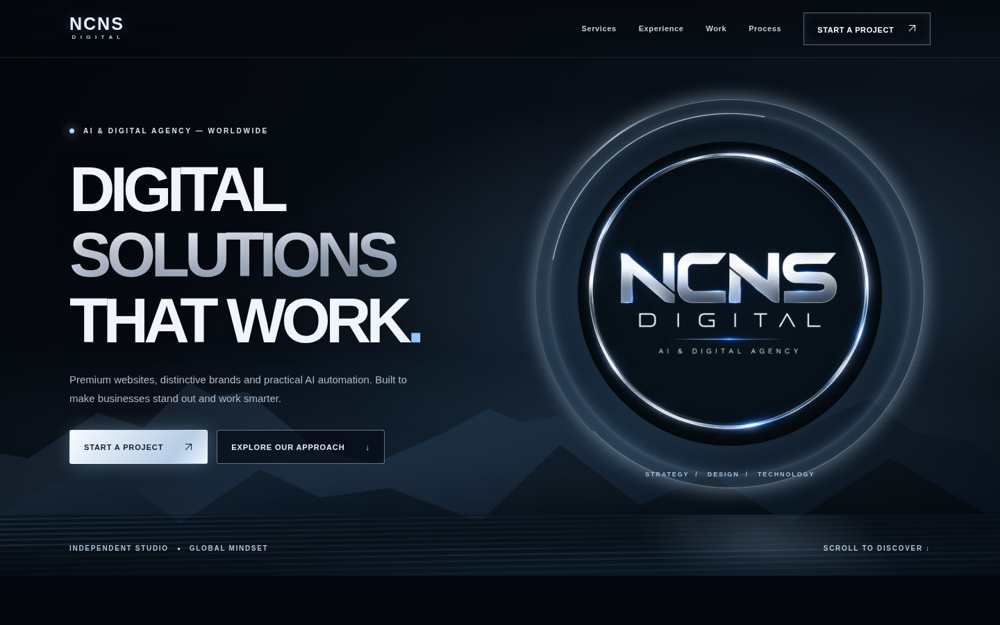
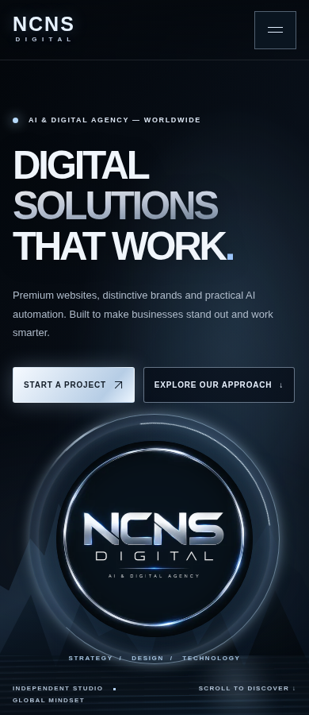

# Issue #1 — milestone A browser QA

Run the static site from the repository root with `python3 -m http.server 8000 --bind 127.0.0.1`, then run `python3 tests/browser_smoke.py`. Requires Python Playwright and system Chromium at `/usr/bin/chromium`. No frontend dependencies or build step.

Chromium validation passed at 1440, 768, 390 and 360 pixels: HTTP 200, original emblem loaded, no horizontal overflow or uncaught JavaScript errors; mobile menu toggles, Escape restores focus, anchor navigation focuses its destination, workflow controls work, and offline brief copy fallback contains the entered text. Reduced-motion and normal-motion atmosphere styles were checked. Screenshots use reduced motion for stable capture. Desktop and 390px screenshots were visually inspected.

Google Fonts requests are blocked in this environment; screenshots show the site's local sans-serif fallback. This is a known external-resource limitation, not a verified web-font rendering result. No performance benchmark, comprehensive accessibility audit, deployment or contact backend is claimed.

`results.json` records the current run. `hero-*.png` show the initial viewport; `screenshot-*.png` show the full page. Existing sections below services were retained without expanding milestone A.

