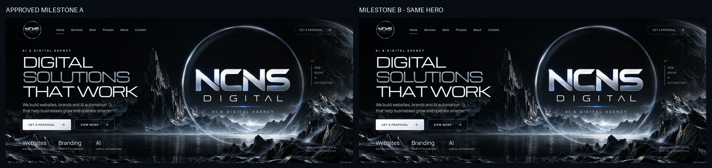

# Milestone B — agency experience and motion

Refs #4. Built on approved `main` commit `87e8de3fcad57830cf0c9078d0d80262cc6df858` in `codex/milestone-b-complete-site-motion`. Milestone A is the visual baseline. Milestone B is for owner review, with no merge, deployment or portfolio development.

## Prepared experience

The approved hero/services retain their artwork, composition and palette. The new sections cover detailed capabilities, a real three-step browser-side requirements builder, an interactive Discover / Design / Build / Improve process, independent-agency About copy, an explicit **Interactive case studies coming next** placeholder, an editable offline project brief and full footer navigation.

The lab validates the goal, assembles chosen scope/timing, copies a useful planning draft and transfers it into the contact brief. Native clipboard and manual-selection fallback paths both work. It makes no AI, pricing, email or backend claim; user text can be entered in any language. No personal information is transmitted, stored persistently or logged by the application.

## Approved hero regression and visual review

[Approved Milestone A / Milestone B hero](hero-before-after.webp) compares the identical 1440×604 hero rectangle with fonts loaded and reduced motion. **Exact pixel difference is zero** in the final run; [results](results.json) also report zero pixels exceeding a 2/255 threshold. The source emblem SHA-256 is unchanged: `75b0a8357126199bae258710941d5b7dccdeb4492607e7a123787a59a327fd01`. The approved base `styles.css` is unchanged.

[Approved visual reference / current hero](reference-vs-current-hero.webp) compares the proportional opening-frame scope. Original reference imagery is visual guidance, not evidence of clients or metrics. The already-approved independent scenic assets and authentic emblem remain intact.



Full desktop, tablet and mobile captures were visually inspected. Capabilities initially display all three explanations, the output textarea grows to fit the draft, and section crops come directly from actual full-page browser captures to avoid fixed-layer screenshot artifacts. The new lower sections continue the black/silver/ice-blue language, with quiet borders, local images and original copy.

Intentional motion changes: the scenery/foreground have minute pointer depth; the lettering itself is never rotated or stretched. Services have a restrained tilt, edge light and arrow movement, with an equally clear keyboard treatment. Headings and groups have small staggered entrances. Navigation marks the active section and updates a thin scroll-progress indicator without intercepting scrolling. CSS motion pauses when the tab is hidden; JS cancels queued pointer work. Reduced motion disables nonessential CSS and JS effects. No animation framework was added.

## Real browser previews

- [Desktop preview, approximately 20s, 1440×900](desktop-preview.webm) · [capture metadata](desktop-preview.json)
- [Mobile preview, approximately 20s, 390×844](mobile-preview.webm) · [capture metadata](mobile-preview.json)

Actual Chromium CDP frames with original timestamps, encoded to VP9 WebM using a millisecond time base. The recorder asserts that encoded duration matches the measured capture (within 0.75s); decoded duration/frame verification is retained in `video-verification.json`. Sequence: normal-motion hero; pointer depth and service hover on desktop; native smooth scrolling; the real requirements builder; copying its result; transfer to the editable offline brief. These are not videos constructed from still QA PNGs. Final encoded files are 19.86s desktop (169 distinct decoded frames) and 19.98s mobile (200 distinct decoded frames). Recordings use normal motion, while PNGs use reduced motion for reproducibility. Desktop and mobile-emulated Chromium are not a physical handset test.

## Acceptance checks

The final suite passed at all five required viewports:

| Viewport | Full page | Hero | Services | Experience | Contact | Menu |
| --- | --- | --- | --- | --- | --- | --- |
| 1440×900 | [PNG](full-1440.png) | [PNG](hero-1440.png) | [PNG](services-1440.png) | [PNG](experience-1440.png) | [PNG](contact-1440.png) | Desktop navigation |
| 1024×768 | [PNG](full-1024.png) | [PNG](hero-1024.png) | [PNG](services-1024.png) | [PNG](experience-1024.png) | [PNG](contact-1024.png) | Desktop navigation |
| 768×900 | [PNG](full-768.png) | [PNG](hero-768.png) | [PNG](services-768.png) | [PNG](experience-768.png) | [PNG](contact-768.png) | [PNG](menu-768.png) |
| 390×844 | [PNG](full-390.png) | [PNG](hero-390.png) | [PNG](services-390.png) | [PNG](experience-390.png) | [PNG](contact-390.png) | [PNG](menu-390.png) |
| 360×780 | [PNG](full-360.png) | [PNG](hero-360.png) | [PNG](services-360.png) | [PNG](experience-360.png) | [PNG](contact-360.png) | [PNG](menu-360.png) |

[Completed lab, desktop](experience-result-1440.png) · [Completed lab, mobile](experience-result-390.png) · [No JavaScript, mobile](no-js-390.png) · [Font failure, mobile](fallback-390.png)

Verified behaviours:

- No horizontal overflow, uncaught JS errors, failed requests or HTTP resource errors; the original emblem and fonts load locally. No data-submission requests occur during interactions.
- Skip link, touch menu, Escape closure/focus restoration, valid anchors and service-detail opening/focus.
- Process tabs support ArrowLeft/ArrowRight, Home and End, with selected states and meaningful panels.
- Builder validation, visible focused fields after step changes, scope/timing choices, multilingual text, clipboard success, manual fallback, edit/back/restart and transfer into the brief. Empty contact text cannot produce a misleading success.
- Halo animation time advances; desktop pointer updates move the scenery and services, not the emblem. Mobile does not run pointer effects. Reduced motion removes animation and resets transforms.
- Hidden-tab state is exercised through a controlled `visibilitychange` event: CSS animation clocks pause and queued pointer work is cancelled. This tests the application's lifecycle handling; it is not claimed as an OS background-tab battery benchmark.
- At 1440 and 390, blocking local fonts leaves non-overflowing readable fallback typography. With JS disabled, content/process panels and mobile navigation are available, and automatic copy buttons remain disabled with honest manual instructions.

[Machine-readable results](results.json): approximately **696 KB desktop / 386 KB mobile**, observed layout shift between **0.0001 and 0.0012**. Transfer figures are subresource totals from PerformanceResourceTiming (the HTML document is excluded). These are local smoke-run observations, not production Core Web Vitals, real-world network timings or a comprehensive accessibility audit.

## Reproduce

From the repository root, start the static server, then run:

```sh
python3 -m http.server 8000 --bind 127.0.0.1
# In a second shell:
node --check main.js
python3 tests/milestone_b_browser.py
python3 tests/record_milestone_b.py
python3 tests/record_milestone_b.py --mobile
```

Requires Python Playwright, Pillow, `/usr/bin/chromium` and FFmpeg for video encoding. No frontend install/build is required. Existing images and fonts are reused; [their provenance/licenses](../../../assets/scenery/README.md) and [exact owner reference](../../../reference/README.md) are preserved. No new stock artwork, third-party scripts or large runtime dependencies.

## Review boundary and next step

The contact channel, backend, live integrations, analytics, deployment and domain remain intentionally unconfigured. Selected Work contains no cases. Owner approval of this complete website is the next step; portfolio concepts belong to Milestone C afterward. Keep the new PR draft and targeting main. Do not merge or deploy.

### Draft PR creation status

Implementation and evidence are pushed in `codex/milestone-b-complete-site-motion`. Creating the requested draft PR with `gh pr create --base main --draft --body-file docs/qa/milestone-b/PR.md` was blocked by `Post https://api.github.com/graphql: Forbidden`. No PR creation is claimed. The ready description is [PR.md](PR.md).

The environment configuration draft already includes `api.github.com`, but the running environment's enforced effective allowlist does not include it. Apply that network setting in environment settings, then retry the draft-creation command. This is an environment/API prerequisite, not a site-deployment step. The branch is ready for review; do not merge or deploy.
